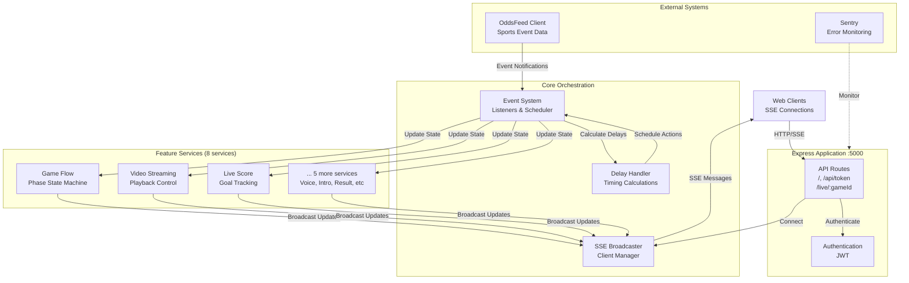
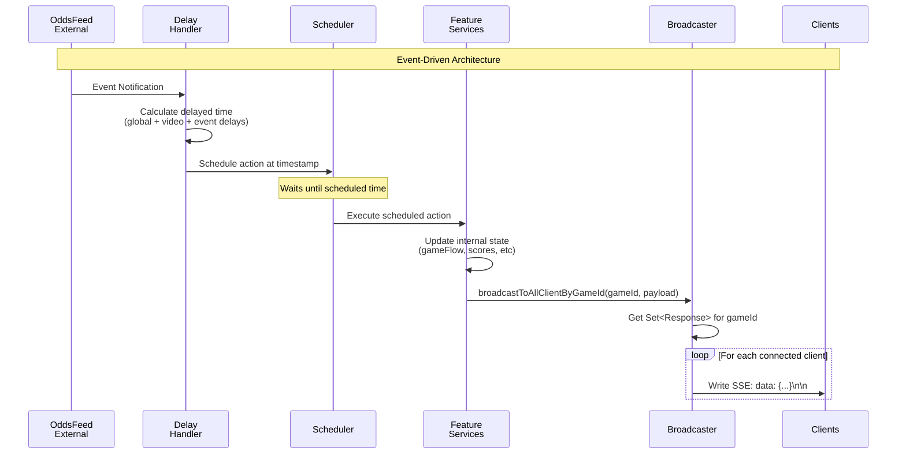
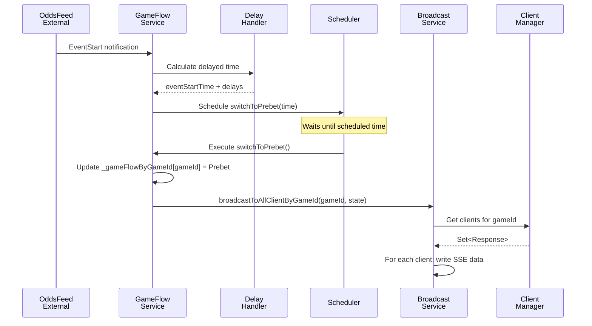
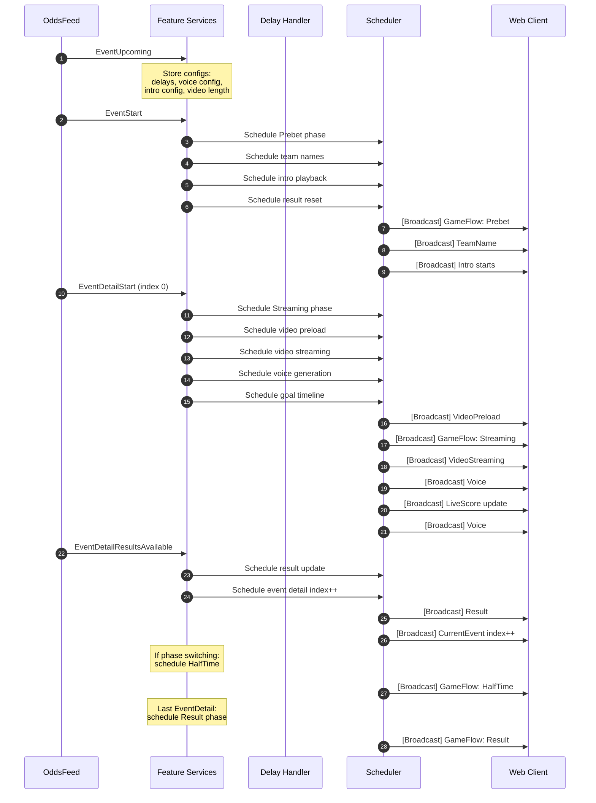

# Streaming Service

A real-time event streaming service built with Node.js, TypeScript, and Express. This service manages live sports events, handles client connections, and broadcasts event updates in real-time using Server-Sent Events (SSE).

## 🚀 Project Overview

The Streaming Service is an **event-driven, real-time sports broadcasting system** that consumes events from an external OddsFeed service and orchestrates synchronized video streaming, live scoring, commentator voices, and UI state transitions for multiple concurrent games.

**Core Purpose:**

- Consume sports event data from `odds-feed-client` (external feed)
- Schedule and coordinate multiple feature services based on event timing
- Broadcast synchronized state updates to connected web clients via SSE
- Handle configurable delays for video synchronization and timing adjustments

**Key Capabilities:**

- **Multi-game concurrent management**: Supports Game IDs 2000-2003 simultaneously
- **Event-driven architecture**: Listens to external OddsFeed events and schedules delayed actions
- **Real-time SSE broadcasting**: Pushes live updates to connected clients per game
- **Phase state management**: Prebet → Streaming → HalfTime → Result transitions
- **Intelligent delay handling**: Configurable global/video/event-type specific delays
- **Video streaming coordination**: Preload and streaming with precise timing
- **Dynamic commentator voice generation**: Context-aware voice selection based on in-game events
- **Live score tracking**: Real-time goal updates during gameplay
- **Debug streaming**: Live service monitoring via SSE for debugging

## 🏗️ Architecture Map

### High-Level Architecture



### Detailed Data Flow



## 🎯 Features & Services

### Core Infrastructure Services

#### 1. Client Manager (`src/managers/client-manager.ts`)

**Purpose**: Manages SSE client connections lifecycle

- **Key Methods**:
  - `addClient(res, gameId)`: Registers new SSE connection for a game
  - `removeClient(gameId, res)`: Removes disconnected client
  - `cleanupDeadConnections()`: Runs every 60s to remove dead connections
  - `getClientSetForGame(gameId)`: Returns Set of Response objects
  - `getConnectionStats()`: Returns client counts per game

- **State Management**: `Map<gameId, Set<Response>>`
- **Auto-cleanup**: Interval runs every 60 seconds

#### 2. Game Broadcast Service (`src/services/game-broadcast.service.ts`)

**Purpose**: Broadcasts SSE messages to all clients for a game

- **Key Method**: `broadcastToAllClientByGameId(gameId, payload, eventName)`
- **Message Format**: `data: {"[eventName]": payload, "message": "FeatureBoardCast"}\n\n`
- **Broadcasting**: Iterates through all clients for a gameId and writes SSE data

#### 3. Event Stream Service (`src/services/event-stream-service.ts`)

**Purpose**: Handles initial SSE connection and sends current state

- **Key Method**: `addClient(res, gameId)`
- **Behavior**:
  1. Registers client with ClientManager
  2. Gets current aggregated state from InGameConsumer
  3. Immediately sends current state to new client

#### 4. Delay Handling Service (`src/features/delay/delay-handling-service.ts`)

**Purpose**: Centralizes timing delay calculations for all events

- **Configuration Source**: `EventUpcoming` event → `event.config.delay`
- **Delay Types**:
  - `globalDelayInMillisecond`: Applied to all events
  - `videoDelayInMillisecond`: Additional delay for video sync
  - `eventScheduleStartDelayInMillisecond`: For EventStart
  - `eventDetailScheduleStartDelayInMillisecond`: For EventDetailStart
  - `eventDetailResultAvailableDelayInMillisecond`: For ResultsAvailable

- **Key Methods**:
  - `getDelayedTime({ eventId, time }, { oddsFeedEventType })`: Returns delayed timestamp
  - `getDelayedTimeWithVideoDelay(...)`: Adds video delay on top

### Feature Services (Event-Driven)

All feature services follow a common pattern:

1. Listen to OddsFeed events via `oddsFeedEventSource`
2. Calculate delayed execution time via `delayHandlingService`
3. Schedule actions via `scheduler`
4. Update internal state when scheduled action executes
5. Broadcast updates via `gameBroadcastService`
6. Log debug info via `featureDebugService`

#### 5. Game Flow Service (`src/features/game-flow/game-flow-service.ts`)

**Purpose**: Manages game phase state machine

**Event Listeners**:

- `EventStart` → schedules `switchToPrebet`
- `EventDetailStart` → schedules `switchToStreaming`
- `EventDetailResultsAvailable` → schedules `switchToHalfTime` or `switchToResult`

**State**: `Record<gameId, GameFlow>`

- `GameFlow.Prebet`: Initial betting phase
- `GameFlow.Streaming`: Active video streaming
- `GameFlow.HalfTime`: Break between halves
- `GameFlow.Result`: Final results displayed

**Broadcast**: `{ state: GameFlow }`

#### 6. Current Event Service (`src/features/current-event/current-event-service.ts`)

**Purpose**: Tracks current event ID and event detail index

**Event Listeners**:

- `EventStart` → schedules `handleEventIndexReset` (sets eventDetailIndex = 0)
- `EventDetailResultsAvailable` → schedules `handleEventDetailIndexIncrement`
- `cleanupOn` → cleans up old event data

**State**:

- `_currentEventByGameId: Record<gameId, eventId>`
- `_currentEventDetailIndexByGameId: Record<gameId, index>`
- `_eventByEventId: Record<eventId, Event>` (for phase lookup)

**Broadcast**: `{ event: eventId, eventDetailIndex: number, phase: number }`

#### 7. Video Streaming Service (`src/features/video-streaming/video-streaming-service.ts`)

**Purpose**: Manages video playback state and preloading

**Event Listener**:

- `EventDetailStart` → schedules both `onLiveStreamStart` and `onLiveStreamPreload`

**Timing**:

- **Preload**: `scheduleStartTs` + global delay (no video delay)
- **Streaming**: `scheduleStartTs` + global delay + video delay

**State**:

- `videoLink`: Playlist URL
- `timeToStream`: Absolute timestamp when video should start
- `currentTime`: Calculated as `Date.now() - timeToStream` (for client sync)
- `phaseIndex`: Current phase number
- `timeFromPhaseStart`: First event detail of this phase
- `timeFromPhaseEnd`: Last event detail of this phase

**Broadcasts**:

- `videoStreaming`: Full video state
- `preloadVideo`: Just the next video link

#### 8. Live Score Service (`src/features/live-score/live-score-service.ts`)

**Purpose**: Tracks real-time goal scoring

**Event Listener**:

- `EventDetailStart` → fetches `goalInfo` JSON, schedules goal updates on timeline

**Goal Timeline Scheduling**:

```typescript
goalInfo.timeLine.forEach((time, goalIndex) => {
  const goalTime = new Date(scheduleStartTs).getTime() + time * 1000;
  const timeToUpdate = delayedTimeWithVideoDelay(goalTime);
  scheduler.schedule(timeToUpdate, handleLiveScoreUpdate);
});
```

**State**: `{ homeScore: number, awayScore: number }` per gameId
**Score Logic**: `result === "H" ? +1 home : result === "A" ? +1 away`

#### 9. Result Service (`src/features/result/result-service.ts`)

**Purpose**: Tracks cumulative results by phase

**Event Listeners**:

- `EventStart` → schedules reset to `{ 0: { homeScore: 0, awayScore: 0 } }`
- `EventDetailResultsAvailable` → schedules result update

**State**: `Record<gameId, { result: Record<phase, { homeScore, awayScore }> }>`
**Accumulation**: Adds event detail result to current phase total

#### 10. Commentator Voice Service (`src/features/commentator-voice/commentator-voice-service.ts`)

**Purpose**: Generates and schedules commentator voice files

**Event Listeners**:

- `EventUpcoming` → fetches voice config JSON
- `EventStart` → resets voice state for new event
- `EventDetailStart` → generates voice timeline, schedules individual voices

**Voice Generation Algorithm** (`src/helpers/voices.ts`):

- Uses `inGameEvent.timeLine` and `inGameEvent.eventName` (e.g., "GOAL", "SAVE")
- Considers previous voices to avoid repetition
- Uses first half voices and score for context
- Applies duration constraints from `VoiceDurationConfig`

**Scheduling**: Each voice scheduled at `scheduleStartTs + timeline[i] + videoDelay`

**State Management**: Tracks voices per phase to build cumulative context

#### 11. Intro Service (`src/features/intro/intro-service.ts`)

**Purpose**: Manages intro video playback timing

**Event Listeners**:

- `EventUpcoming` → stores intro config (duration, resourceServer)
- `EventStart` → schedules intro playback for Prebet and HalfTime

**Intro Timing**:

1. **Prebet Intro**: Plays at `EventStart` for `duration` seconds
2. **HalfTime Intro**: Plays `duration` seconds before 2nd half starts

**State**: `{ resourceServer, introTime, timeToPlay, isPlaying, duration }`

#### 12. Team Name Service (`src/features/team-name/team-name-service.ts`)

**Purpose**: Broadcasts team names at event start

**Event Listener**:

- `EventStart` → schedules team name broadcast

**State**: `{ homeTeamName, awayTeamName }` from `event.eventNameAKey/eventNameBKey`

### Support Services

#### 13. In-Game Consumer (`src/features/in-game-consumer/in-game-consumer.ts`)

**Purpose**: Aggregates current state from all feature services

**Method**: `getCurrentByGameId(gameId)` returns:

```typescript
{
  gameFlow: { state: "Prebet" | "Streaming" | ... },
  currentEvent: { event, eventDetailIndex, phase },
  videoStreaming: { videoLink, currentTime, ... },
  preloadVideo: { videoLink },
  result: { result: { [phase]: { homeScore, awayScore } } },
  liveScore: { homeScore, awayScore },
  teamName: { homeTeamName, awayTeamName },
  intro: { resourceServer, introTime, isPlaying, duration }
}
```

Used by `EventStreamService` to send initial state to new connections.

#### 14. Feature Debug Service (`src/features/feature-debug/feature-debug-service.ts`)

**Purpose**: Centralized logging with color-coded output

- **Console Logging**: Only logs enabled services (currently only GameFlowService)
- **Debug Stream**: Stores last 1000 logs per gameId
- **EventEmitter**: Broadcasts logs to debug stream clients
- **Log Format**: `{ serviceName, message, serviceColor, absoluteTime, relativeTime }`
- **Relative Time**: Calculated from GameFlowService track point (Prebet start)

## 🔄 Event-Driven Flow

This system uses a **scheduler-based event-driven architecture**, not cron jobs. All feature services listen to external OddsFeed events and schedule delayed actions.

### Primary Event Flow



### Complete Event Timeline



### Scheduler Details

The `Scheduler` is provided by `odds-feed-client` library:

- **API**: `schedule(date: Date, callback: Function)`
- **Implementation**: Likely uses `setTimeout` or similar
- **Precision**: Schedules callbacks to execute at specific timestamps
- **Cleanup**: Services dispose scheduled tasks on shutdown

### OddsFeed Events

**Event Notifications** (Event-level):

- `EventUpcoming`: Pre-event notification with configs
- `EventStart`: Event begins (triggers Prebet phase)
- Cleanup: Memory cleanup for old events

**Event Detail Notifications** (Per event detail within an event):

- `EventDetailStart`: Video/detail begins (triggers Streaming phase)
- `EventDetailResultsAvailable`: Results for this detail (triggers HalfTime/Result)

**System Notifications**:

- Cleanup events for memory management

## 🛠️ Technical Stack

### Core Technologies

- **Node.js** (v24) with **TypeScript 5.9**
- **Express.js 5.1** for HTTP server and routing
- **Server-Sent Events (SSE)** for real-time unidirectional communication
- **Awilix 12.0** for dependency injection (PROXY mode)
- **Jest 30.1** for testing framework

### External Dependencies

- **odds-feed-client 2.0**: External event data integration
  - Provides `OddsFeedEventSource`, `Scheduler`, `OddsFeedService`
  - Event-driven architecture with typed notifications
- **sc-common 3.0**: Shared logging and utilities
  - Provides `logger` with Sentry integration
- **jsonwebtoken 9.0**: JWT authentication
- **cors 2.8** with **tldts 7.0**: CORS with domain validation
- **chance 1.1**: Random voice selection

### Development Tools

- **tsx 4.20**: TypeScript execution for development
- **ts-jest 29.4**: TypeScript Jest transformer
- **prettier 3.6**: Code formatting
- **Docker**: Containerization (see `Dockerfile`)
- **Sentry**: Error monitoring and performance tracking

### Build & Deployment

- **Build**: TypeScript compilation + static files copy
- **Runtime**: `extensionless` loader for ES modules without extensions
- **Module System**: ES Modules (`"type": "module"`)

## 📋 Component Guide

### Application Initialization

**File**: `src/app.ts`

```typescript
const run = async () => {
  // 1. Initialize Sentry and logging
  const configuration = new Configuration();
  await configuration.configureDatabaseAndSentry(appConfigs);

  // 2. Setup dependency injection
  const containerRegistry = new ContainerRegistry();
  const container = containerRegistry.register(); // Register all services
  containerRegistry.init(); // Initialize event listeners

  // 3. Configure Express
  const app = express();
  app.use(express.static(path.join(process.cwd(), "public")));
  app.use(express.json());
  app.use(corsMiddleware);

  // 4. Setup routes
  app.use(setupRoutes(container));
  app.use(errorHandler);

  // 5. Start server
  const server = app.listen(appConfigs.hostingPort);

  // 6. Graceful shutdown handlers
  process.on("SIGTERM", async () => gracefulShutdown("SIGTERM"));
  process.on("SIGINT", async () => gracefulShutdown("SIGINT"));
};
```

### Dependency Injection

**Main Container** (`src/container-registry.ts`):

```typescript
// 1. Register odds-feed-client services
register(this.diContainer);

// 2. Register core services
this.container.register({
  clientManager: asClass(ClientManager).singleton().disposer(...)
  eventStreamService: asClass(EventStreamService).singleton(),
  authenticateService: asClass(AuthenticateService).singleton(),
});

// 3. Register controllers
this.container.register({
  authController: asClass(AuthController).singleton(),
  eventStreamController: asClass(EventStreamController).singleton(),
});

// 4. Register feature services (with lazy loading)
registerContainer(this.container);

// 5. Initialize all feature services
init(this.diContainer);
initContainer(this.container);
```

**Feature Services** (`src/features/container-registry.ts`):

Uses **lazy loading** with Proxy pattern to handle circular dependencies:

```typescript
// Circular dependency: GameFlowService ↔ FeatureDebugService
container.register({
  gameFlowService: asFunction((cradle) => new GameFlowService({
    featureDebugService: lazy(() => cradle.featureDebugService), // Lazy!
    // ... other deps
  })).singleton().disposer(...),

  featureDebugService: asFunction((cradle) => new FeatureDebugService({
    gameFlowService: lazy(() => cradle.gameFlowService), // Lazy!
  })).singleton().disposer(...),
});
```

**Initialization** calls `initEvent()` on all feature services to register event listeners.

### API Routes

**File**: `src/routes/index.ts`

| Method | Path                    | Auth | Controller            | Purpose                           |
| ------ | ----------------------- | ---- | --------------------- | --------------------------------- |
| GET    | `/`                     | No   | HealthController      | Health check with connection info |
| POST   | `/api/token`            | No   | AuthController        | JWT token generation              |
| GET    | `/live/:gameId`         | No\* | EventStreamController | SSE event stream connection       |
| GET    | `/debug-stream/:gameId` | No\* | DebugController       | Debug logging SSE stream          |

\*Note: JWT middleware (`verifyJWT`) is **not currently applied** to these routes. This is a potential security issue.

### Controllers

#### Health Controller (`src/controllers/health-controller.ts`)

```typescript
healthCheck(req, res) {
  res.json({
    status: "ok",
    message: "Streaming service running",
    timestamp: new Date().toISOString(),
    clientIP: req.ip,
    host: req.headers.host,
    forwardedFor: req.headers["x-forwarded-for"],
    remoteAddress: req.socket.remoteAddress,
  });
}
```

#### Auth Controller (`src/controllers/auth-controller.ts`)

```typescript
async login(req, res) {
  const { operatorId, password } = req.body;
  const token = await authenticateService.getAuthenticatedToken(operatorId, password);
  res.json({ token });
}
```

Validates against hardcoded credentials in `appConfigs.jwt`.

#### Event Stream Controller (`src/controllers/event-stream-controller.ts`)

```typescript
handleEventStreamConnection(req, res) {
  const gameId = req.params.gameId;

  // Setup SSE headers
  res.setHeader("Content-Type", "text/event-stream");
  res.setHeader("Cache-Control", "no-cache");
  res.setHeader("Connection", "keep-alive");
  res.flushHeaders();

  // Add client and send initial state
  eventStreamService.addClient(res, gameId);
}
```

#### Debug Controller (`src/controllers/debug-controller.ts`)

Similar SSE setup, but:

1. Gets debug event emitter for gameId
2. Sends historical logs (last 1000)
3. Converts ANSI colors to HTML colors
4. Streams new logs as they arrive

### Middlewares

#### CORS Middleware (`src/middlewares/cors.ts`)

```typescript
validateOrigin(origin, host) {
  // Allow if no origin (same-origin)
  if (!origin) return true;

  // Allow localhost:7456-7459
  if (/^https?:\/\/localhost:745(6|7|8|9)$/.test(origin)) return true;

  // Allow same domain
  const originDomain = getDomain(origin); // Uses tldts
  const hostDomain = getDomain(host);
  return originDomain === hostDomain;
}
```

Applied to all routes except `/`.

#### Error Handler (`src/middlewares/error-handler.ts`)

**Current**: Very basic, returns 400 for all errors

```typescript
export const errorHandler = (err, req, res, next) => {
  res.status(400).json({ error: "Bad Request", message: err.message });
};
```

#### Verify JWT (`src/middlewares/verify-jwt.ts`)

Checks `Authorization: Bearer <token>` or query param `?token=<token>`.

**Not currently used** in route setup.

### Configuration

**App Configs** (`src/app-configs.ts`):

```typescript
export const appConfigs = {
  hostingPort: 5000,
  sentry: { sentryUrl: "...", logIdentifier: "Streaming-Service", env: "DEV" },
  jwt: { username: "marble-tv", password: "marble-tv-123", secret: "stream-service-secret" },
  oddsFeedAPI: { url: "...", operatorId: "...", password: "..." },
};
```

**Environment-specific configs**: `configs/app-configs.LOCAL.js`, `app-configs.UAT.js`, `app-configs.KLPROD.js` (not currently loaded)

**App Settings** (`src/app-settings.ts`):

Fallback settings per game ID:

- `videoLength`: Default 30 seconds for games 2000-2003
- `scheduleDelay`: 10s for games 2001-2003
- `videoDelay`: 3s for all games
- `introDuration`: 8s for game 2000

### Helper Utilities

**ID Helper** (`src/helpers/id-helper.ts`):

Event ID encoding: `eventId = (gameId << 32) + roundId`

```typescript
extractGameId(eventId: number): string // Returns gameId as string
extractRoundId(eventId: number): number
createEventId(gameId: number, roundId: number): number
```

**Phase Helper** (`src/helpers/phase-helper.ts`):

```typescript
isPhaseSwitching({ event, index }); // true if next detail has different phase
isLastEventDetail({ event, index }); // true if this is last detail
```

**Voice Generator** (`src/helpers/voices.ts`):

Complex algorithm for voice selection:

- Avoids repeating recent voices
- Considers event types (GOAL, SAVE, etc.)
- Uses duration constraints
- Contextual based on first half score

## 🔧 Improvements & Refactors

### High Priority

#### 1. Security: Remove Hardcoded Credentials

**Scope**: Small | **Impact**: Critical

**Current Issue**:

```typescript
// src/app-configs.ts (lines 8-12)
jwt: {
  username: "marble-tv",
  password: "marble-tv-123",
  secret: "stream-service-secret",
},
```

**Improvement**:

```typescript
// Use environment variables
jwt: {
  username: process.env.JWT_USERNAME || throwError("JWT_USERNAME required"),
  password: process.env.JWT_PASSWORD || throwError("JWT_PASSWORD required"),
  secret: process.env.JWT_SECRET || throwError("JWT_SECRET required"),
},
```

**Files to Update**:

- `src/app-configs.ts`: Load from environment variables
- Add `.env.example` file with template
- Update `src/configuration.ts` to validate required env vars

**Benefits**: Security, compliance, environment-specific credentials

---

#### 2. Security: Add JWT Authentication to Routes

**Scope**: Small | **Impact**: High

**Current Issue**:

```typescript
// src/routes/index.ts (lines 17-18)
router.get("/live/:gameId", (req, res) => eventStreamController.handleEventStreamConnection(req, res));
router.get("/debug-stream/:gameId", (req, res) => debugController.handle(req, res));
```

The `verifyJWT` middleware exists (`src/middlewares/verify-jwt.ts`) but is **never applied**.

**Improvement**:

```typescript
import { verifyJWT } from "../middlewares/verify-jwt";

router.get("/live/:gameId", verifyJWT, (req, res) => eventStreamController.handleEventStreamConnection(req, res));
router.get("/debug-stream/:gameId", verifyJWT, (req, res) => debugController.handle(req, res));
```

**Files to Update**:

- `src/routes/index.ts`: Add `verifyJWT` middleware

**Benefits**: Prevents unauthorized access to streaming endpoints

---

#### 3. Error Handling Enhancement

**Scope**: Medium | **Impact**: High

**Current Issue**:

```typescript
// src/middlewares/error-handler.ts (lines 3-5)
export const errorHandler = (err, req, res, next) => {
  res.status(400).json({ error: "Bad Request", message: err.message });
};
```

All errors return 400. No error categorization, logging, or proper HTTP status codes.

**Improvement**:

Create structured error classes:

```typescript
// src/errors/AppError.ts
export class AppError extends Error {
  constructor(
    public message: string,
    public statusCode: number,
    public isOperational = true
  ) {
    super(message);
  }
}

export class ValidationError extends AppError {
  constructor(message: string) {
    super(message, 400);
  }
}

export class AuthenticationError extends AppError {
  constructor(message: string) {
    super(message, 401);
  }
}

export class NotFoundError extends AppError {
  constructor(message: string) {
    super(message, 404);
  }
}
```

Enhanced error handler:

```typescript
// src/middlewares/error-handler.ts
import { logger } from "sc-common";
import { AppError } from "../errors/AppError";

export const errorHandler = (err, req, res, next) => {
  // Default to 500 server error
  let statusCode = 500;
  let message = "Internal Server Error";

  if (err instanceof AppError) {
    statusCode = err.statusCode;
    message = err.message;
  } else if (err.name === "ValidationError") {
    statusCode = 400;
    message = err.message;
  } else if (err.name === "UnauthorizedError") {
    statusCode = 401;
    message = "Unauthorized";
  }

  // Log error with context
  logger.error("Request error", {
    error: err.message,
    stack: err.stack,
    statusCode,
    path: req.path,
    method: req.method,
  });

  res.status(statusCode).json({
    error: message,
    ...(process.env.NODE_ENV === "development" && { stack: err.stack }),
  });
};
```

**Files to Update**:

- Create `src/errors/AppError.ts`
- Update `src/middlewares/error-handler.ts`
- Update controllers to throw specific errors

**Benefits**: Better debugging, proper HTTP status codes, clearer error messages

---

#### 4. Type Safety: Remove Type Assertions

**Scope**: Medium | **Impact**: Medium

**Current Issue** (multiple locations):

```typescript
// src/features/delay/delay-handling-service.ts (line 60)
const config = (event as any).config.delay as DelayConfig;

// src/features/commentator-voice/commentator-voice-service.ts (lines 126, 130)
const videoLength = (event as any).config?.video?.videoLength ?? ...;
const config = (event as any).config.voice as CommentatorVoiceConfig;

// src/features/intro/intro-service.ts (line 83)
const config = (event as any).config?.intro as IntroConfig;
```

**Root Cause**: The `Event` type (`src/types/index.ts`) doesn't include the `config` field that comes from OddsFeed.

**Improvement**:

Update type definitions:

```typescript
// src/types/index.ts
export type Event = {
  eventID: number;
  eventNameAKey: string;
  eventNameBKey: string;
  theme?: string;
  scheduleStartTs: string;
  productCode: string;
  productTypeKey: string;
  eventDetails: EventDetail[];
  voiceConfig?: string;
  // Add config field
  config?: EventConfig;
};

export type EventConfig = {
  delay?: DelayConfig;
  video?: {
    videoLength?: number;
  };
  voice?: CommentatorVoiceConfig;
  intro?: IntroConfig;
};

export type DelayConfig = {
  globalDelayInMillisecond?: number;
  videoDelayInMillisecond?: number;
  eventScheduleStartDelayInMillisecond?: number;
  eventDetailScheduleStartDelayInMillisecond?: number;
  eventDetailResultAvailableDelayInMillisecond?: number;
};

export type CommentatorVoiceConfig = {
  configJson: string;
  configVoice: VoiceDurationConfig;
};

export type IntroConfig = {
  resourceServer: string;
  duration: number;
};
```

Then remove all `as any` casts:

```typescript
// src/features/delay/delay-handling-service.ts
const config = event.config?.delay;

// src/features/commentator-voice/commentator-voice-service.ts
const videoLength = event.config?.video?.videoLength ?? ...;
const config = event.config?.voice;

// src/features/intro/intro-service.ts
const config = event.config?.intro;
```

**Files to Update**:

- `src/types/index.ts`: Add complete type definitions
- All feature services: Remove type assertions

**Benefits**: Compile-time safety, better IDE autocomplete, catches errors early

---

### Medium Priority

#### 5. Circular Dependency Simplification

**Scope**: Medium | **Impact**: Medium

**Current Issue**:

```typescript
// src/features/container-registry.ts (lines 45-60)
gameFlowService: asFunction((cradle) => new GameFlowService({
  featureDebugService: lazy(() => cradle.featureDebugService),
  // ...
})),
featureDebugService: asFunction((cradle) => new FeatureDebugService({
  gameFlowService: lazy(() => cradle.gameFlowService),
})),
```

**Root Cause**: `GameFlowService` logs to `FeatureDebugService`, which needs `GameFlowService.getTrackPointByGameId()` for relative time calculation.

**Improvement Option 1** (Better separation):

Extract timing logic to a separate `TimeTrackingService`:

```typescript
class TimeTrackingService {
  private trackPointByGameId: Record<string, number> = {};

  setTrackPoint(gameId: string, timestamp: number) {
    this.trackPointByGameId[gameId] = timestamp;
  }

  getRelativeTime(gameId: string): number {
    return (Date.now() - (this.trackPointByGameId[gameId] ?? Date.now())) / 1000;
  }
}
```

Then:

- `GameFlowService` updates track point when switching to Prebet
- `FeatureDebugService` uses `TimeTrackingService` for relative time
- No circular dependency

**Improvement Option 2** (Event-based):

Use events instead of direct dependency:

```typescript
// GameFlowService emits 'trackPointUpdated' event
// FeatureDebugService listens to it
```

**Files to Update**:

- Create `src/services/time-tracking-service.ts`
- Update `src/features/game-flow/game-flow-service.ts`
- Update `src/features/feature-debug/feature-debug-service.ts`
- Update `src/features/container-registry.ts`

**Benefits**: Simpler DI setup, easier to test, clearer responsibilities

---

#### 6. Client Connection Resilience

**Scope**: Small | **Impact**: Medium

**Current Issue**:

```typescript
// src/managers/client-manager.ts (lines 62-79)
cleanupDeadConnections() {
  for (const [gameId, clients] of this.clients) {
    for (const client of clients) {
      if (client.destroyed || client.writableEnded) {
        clients.delete(client);
      }
    }
  }
}
```

- No heartbeat/keepalive mechanism
- No connection timeout detection
- No metrics on connection health

**Improvement**:

Add SSE heartbeat:

```typescript
// Send comment every 30s to keep connection alive
const HEARTBEAT_INTERVAL = 30000;

class ClientManager {
  private heartbeatInterval: NodeJS.Timeout;

  constructor(container) {
    // ... existing code

    // Send heartbeat to all clients
    this.heartbeatInterval = setInterval(() => {
      for (const [gameId, clients] of this.clients) {
        for (const client of clients) {
          try {
            if (!client.destroyed && !client.writableEnded) {
              client.write(": heartbeat\n\n");
            }
          } catch (err) {
            this.logService.error("Heartbeat failed", { gameId, error: err });
            clients.delete(client);
          }
        }
      }
    }, HEARTBEAT_INTERVAL);
  }

  destroy() {
    clearInterval(this.heartbeatInterval);
    // ... existing code
  }
}
```

Add connection metrics:

```typescript
private connectionMetrics = {
  totalConnections: 0,
  activeConnections: 0,
  disconnections: 0,
  errors: 0,
};

addClient(res, gameId) {
  this.connectionMetrics.totalConnections++;
  this.connectionMetrics.activeConnections++;
  // ... existing code
}

removeClient(gameId, res) {
  this.connectionMetrics.activeConnections--;
  this.connectionMetrics.disconnections++;
  // ... existing code
}
```

**Files to Update**:

- `src/managers/client-manager.ts`
- Optionally add `/metrics` endpoint to expose stats

**Benefits**: Better connection stability, improved monitoring, fewer silent failures

---

#### 7. Configuration Management Consolidation

**Scope**: Medium | **Impact**: Medium

**Current Issue**:

Multiple configuration sources:

- `src/app-configs.ts`: Hardcoded configs
- `configs/app-configs.LOCAL.js`: Environment-specific (not loaded)
- `src/app-settings.ts`: Game-specific fallbacks
- Event-level configs from OddsFeed

**Improvement**:

Consolidate into layered config system:

```typescript
// src/config/index.ts
import { z } from "zod"; // Add zod for validation

const ConfigSchema = z.object({
  port: z.number().default(5000),
  nodeEnv: z.enum(["development", "production", "test"]),
  sentry: z.object({
    url: z.string().url(),
    logIdentifier: z.string(),
    env: z.string(),
  }),
  jwt: z.object({
    secret: z.string().min(32),
    expiresIn: z.string().default("2h"),
  }),
  auth: z.object({
    username: z.string(),
    password: z.string(),
  }),
  oddsFeed: z.object({
    url: z.string().url(),
    operatorId: z.string(),
    password: z.string(),
  }),
  games: z.record(
    z.object({
      videoLength: z.number().positive(),
      scheduleDelay: z.number().nonnegative(),
      videoDelay: z.number().nonnegative(),
    })
  ),
});

export const loadConfig = () => {
  const config = {
    port: Number(process.env.PORT) || 5000,
    nodeEnv: process.env.NODE_ENV || "development",
    sentry: {
      url: process.env.SENTRY_URL!,
      logIdentifier: "Streaming-Service",
      env: process.env.NODE_ENV || "DEV",
    },
    jwt: {
      secret: process.env.JWT_SECRET!,
      expiresIn: process.env.JWT_EXPIRES_IN || "2h",
    },
    auth: {
      username: process.env.AUTH_USERNAME!,
      password: process.env.AUTH_PASSWORD!,
    },
    oddsFeed: {
      url: process.env.ODDS_FEED_URL!,
      operatorId: process.env.ODDS_FEED_OPERATOR_ID!,
      password: process.env.ODDS_FEED_PASSWORD!,
    },
    games: {
      "2000": { videoLength: 30, scheduleDelay: 0, videoDelay: 3000 },
      "2001": { videoLength: 30, scheduleDelay: 10000, videoDelay: 3000 },
      // ...
    },
  };

  return ConfigSchema.parse(config); // Validates and throws if invalid
};
```

**Files to Update**:

- Create `src/config/index.ts`
- Remove `src/app-configs.ts` and `src/app-settings.ts`
- Update all imports

**Benefits**: Single source of truth, validation, type safety, easier testing

---

### Low Priority

#### 8. Memory Leak Prevention

**Scope**: Small | **Impact**: Low

**Current Issue**:

Event listeners are bound but cleanup might not always happen:

```typescript
// src/features/game-flow/game-flow-service.ts (lines 34-36)
private readonly boundHandleEventStart: (notification: EventNotification) => void;
private readonly boundHandleResultAvailable: (notification: EventDetailNotification) => void;
private readonly boundHandleEventDetailScheduleStart: (notification: EventDetailNotification) => void;
```

These are properly disposed in `dispose()`, but if disposal fails, listeners remain.

**Improvement**:

Add defensive cleanup and monitoring:

```typescript
export class GameFlowService {
  private disposed = false;

  dispose() {
    if (this.disposed) {
      console.warn("GameFlowService already disposed");
      return;
    }

    try {
      this.oddsFeedEventSource.eventOff(OddsFeedEventName.EventStart, this.boundHandleEventStart);
      // ... other cleanup

      this.disposed = true;
      console.log("GameFlowService disposed successfully");
    } catch (err) {
      console.error("Error disposing GameFlowService", err);
      throw err;
    }
  }

  // Add guard to public methods
  public handleEventStart({ event }: EventNotification) {
    if (this.disposed) {
      console.warn("GameFlowService used after disposal");
      return;
    }
    // ... existing logic
  }
}
```

Add memory monitoring:

```typescript
// src/helpers/memory-monitor.ts
export const logMemoryUsage = () => {
  const used = process.memoryUsage();
  console.log({
    rss: `${Math.round(used.rss / 1024 / 1024)}MB`,
    heapTotal: `${Math.round(used.heapTotal / 1024 / 1024)}MB`,
    heapUsed: `${Math.round(used.heapUsed / 1024 / 1024)}MB`,
    external: `${Math.round(used.external / 1024 / 1024)}MB`,
  });
};

// In app.ts
setInterval(logMemoryUsage, 60000); // Log every minute
```

**Files to Update**:

- All feature services: Add disposal guards
- `src/app.ts`: Add memory monitoring

**Benefits**: Prevents memory leaks, easier debugging, better production stability

---

#### 9. Testing Coverage Expansion

**Scope**: Large | **Impact**: Medium

**Current State**: Tests exist in `tests/unit-tests/` but coverage unknown.

**Improvement Areas**:

1. **Service Integration Tests**:

```typescript
// tests/integration/event-flow.test.ts
describe("Event Flow Integration", () => {
  it("should transition through game phases correctly", async () => {
    // Mock OddsFeed events
    // Verify GameFlowService broadcasts
    // Verify all dependent services update
  });

  it("should handle video streaming with delays", async () => {
    // Test delay calculations
    // Verify video preload before streaming
    // Verify timing accuracy
  });
});
```

2. **SSE Connection Tests**:

```typescript
// tests/integration/sse-connection.test.ts
describe("SSE Connections", () => {
  it("should send initial state to new connections", async () => {
    const response = await request(app).get("/live/2000");
    // Verify SSE headers
    // Verify initial state message
  });

  it("should broadcast updates to all clients", async () => {
    // Connect multiple clients
    // Trigger game flow change
    // Verify all clients receive update
  });
});
```

3. **Error Scenarios**:

```typescript
describe("Error Handling", () => {
  it("should handle malformed event data", async () => {
    // Send invalid event
    // Verify service doesn't crash
    // Verify error logged
  });

  it("should handle client disconnection", async () => {
    // Connect and disconnect
    // Verify cleanup
    // Verify no memory leak
  });
});
```

**Files to Create**:

- `tests/integration/` directory
- `tests/e2e/` directory
- Update `jest.config.cjs` for integration tests

**Benefits**: Catch regressions early, confidence in refactoring, documentation through tests

---

## 📊 Monitoring & Observability

### Current Monitoring

1. **Sentry Integration** (`src/configuration.ts`):
   - Error tracking via `sc-common` logger
   - Configured with `sentryUrl`, `logIdentifier`, and `env`

2. **Debug Service** (`/debug-stream/:gameId`):
   - Real-time service logging via SSE
   - Color-coded by service
   - Shows relative time from Prebet start
   - Last 1000 logs stored per game

3. **Health Endpoint** (`/`):
   - Returns service status
   - Client IP and connection info
   - No service health checks

### Recommended Enhancements

1. **Structured Logging**:

```typescript
logger.info("Client connected", {
  gameId,
  clientIP: req.ip,
  totalClients: clientManager.getTotalClientCount(),
});
```

2. **Metrics Collection**:
   - Connection counts per game
   - Event processing latency
   - Scheduler queue depth
   - Memory usage trends

3. **Health Checks**:

```typescript
// GET /health
{
  status: "healthy",
  checks: {
    oddsFeed: "connected",
    scheduler: "active",
    sentry: "connected",
  },
  metrics: {
    totalConnections: 42,
    gamesActive: ["2000", "2001"],
  }
}
```

4. **Alerting**:
   - High error rate
   - No events received for X minutes
   - Memory usage > threshold
   - Connection drops

## 🚀 Deployment

### Environment Variables

**Required**:

```bash
NODE_ENV=production
PORT=5000

# Sentry
SENTRY_URL=https://...@sentry.../project-id

# JWT
JWT_SECRET=your-strong-secret-min-32-chars
JWT_USERNAME=your-username
JWT_PASSWORD=your-password

# OddsFeed
ODDS_FEED_URL=https://odds-feed-api.example.com
ODDS_FEED_OPERATOR_ID=your-operator-id
ODDS_FEED_PASSWORD=your-password
```

### Docker Deployment

**Build**:

```bash
docker build -t streaming-service:latest .
```

**Run**:

```bash
docker run -d \
  -p 5000:5000 \
  -e NODE_ENV=production \
  -e SENTRY_URL=$SENTRY_URL \
  -e JWT_SECRET=$JWT_SECRET \
  --name streaming-service \
  streaming-service:latest
```

**Dockerfile** (at root):

- Multi-stage build
- Installs dependencies
- Compiles TypeScript
- Copies static files
- Runs with Node.js

### Production Considerations

1. **Load Balancing**:
   - SSE connections are stateful
   - Use sticky sessions if load balancing
   - Or implement Redis pub/sub for multi-instance broadcasting

2. **Health Checks**:
   - Kubernetes: Readiness probe on `/health`
   - Liveness probe on `/`

3. **Graceful Shutdown**:
   - Already implemented (lines 33-48 in `src/app.ts`)
   - Waits 10 seconds for connections to close
   - Calls `container.dispose()` to cleanup

4. **Resource Limits**:
   - Memory: Depends on client count (estimate ~50MB + 1KB per connection)
   - CPU: Low except during event processing

5. **Monitoring**:
   - Monitor connection counts
   - Watch for memory growth
   - Track event processing latency

## 📝 Development

### Running Locally

```bash
# Install dependencies
npm install  # or yarn

# Development with auto-reload
npm run dev

# Build for production
npm run build

# Start production build
npm start
```

### Testing

```bash
# Run all tests
npm test

# Run with coverage
npm run test-coverage

# Format code
npm run format

# Check formatting
npm run lint
```

### Debugging

1. **Debug Stream**: Open `http://localhost:5000/debug-stream/2000` (replace 2000 with gameId)
2. **Health Check**: `http://localhost:5000/`
3. **Connect Client**: `http://localhost:5000/live/2000`

### Project Structure

```
src/
├── app.ts                      # Entry point
├── configuration.ts            # Sentry setup
├── container-registry.ts       # Main DI container
├── app-configs.ts             # Hardcoded configs (to be replaced)
├── app-settings.ts            # Game-specific fallbacks
├── types/                     # TypeScript type definitions
├── controllers/               # HTTP request handlers
│   ├── auth-controller.ts
│   ├── event-stream-controller.ts
│   ├── health-controller.ts
│   └── debug-controller.ts
├── middlewares/               # Express middlewares
│   ├── cors.ts
│   ├── error-handler.ts
│   └── verify-jwt.ts
├── routes/                    # Route definitions
│   └── index.ts
├── managers/                  # Infrastructure managers
│   └── client-manager.ts
├── services/                  # Core services
│   ├── authenticate-service.ts
│   ├── event-stream-service.ts
│   └── game-broadcast.service.ts
├── features/                  # Feature services
│   ├── container-registry.ts
│   ├── commentator-voice/
│   ├── current-event/
│   ├── delay/
│   ├── feature-debug/
│   ├── game-flow/
│   ├── in-game-consumer/
│   ├── intro/
│   ├── live-score/
│   ├── result/
│   ├── team-name/
│   └── video-streaming/
└── helpers/                   # Utility functions
    ├── id-helper.ts
    ├── phase-helper.ts
    ├── voices.ts
    └── log.ts
```

## 📚 Additional Resources

- **odds-feed-client**: External library documentation (not public)
- **Server-Sent Events**: [MDN SSE Guide](https://developer.mozilla.org/en-US/docs/Web/API/Server-sent_events)
- **Awilix DI**: [Awilix Documentation](https://github.com/jeffijoe/awilix)

## 📝 License

This project is proprietary and confidential.

## 🆘 Support

For support and questions:

- Create an issue in the repository
- Contact the development team
- Check the debug stream for real-time service status: `/debug-stream/:gameId`
- Review logs for debugging information

---

**Last Updated**: Based on codebase analysis October 2025
