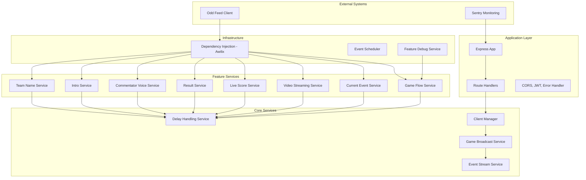
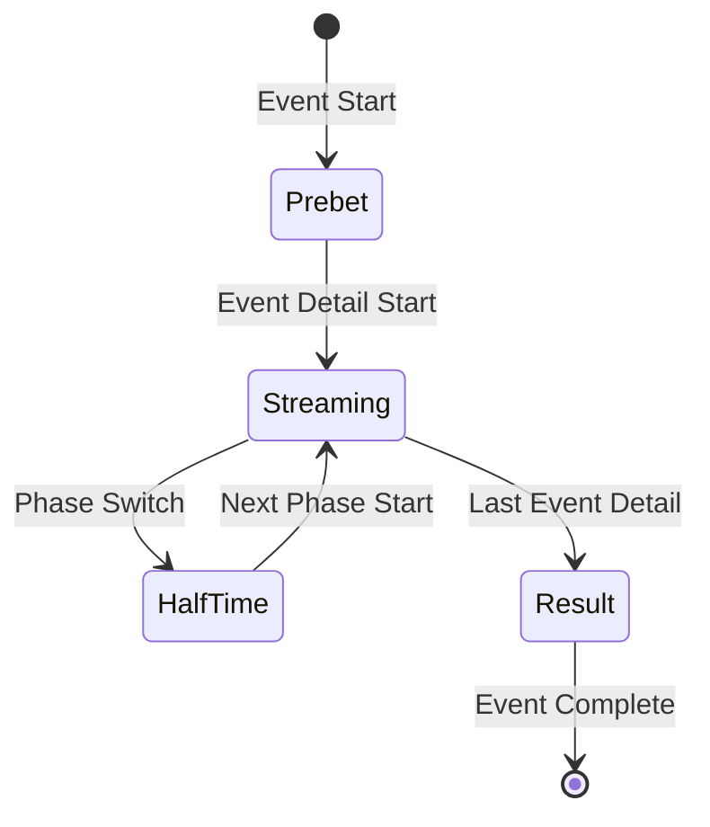

# Streaming Service

A real-time event streaming service built with Node.js, TypeScript, and Express. This service manages live sports events, handles client connections, and broadcasts event updates in real-time using Server-Sent Events (SSE).

## 🚀 Project Overview

The Streaming Service is a sophisticated real-time event management system designed for live sports broadcasting. It orchestrates multiple game phases, manages client connections, and provides real-time updates through Server-Sent Events (SSE). The system handles complex event scheduling, video streaming coordination, live scoring, and commentator voice generation.

**Key Capabilities:**

- Multi-game concurrent management (Game IDs: 2000, 2001, 2002, 2003)
- Real-time event phase transitions (Prebet → Streaming → HalfTime → Result)
- Intelligent delay handling and scheduling
- Live video streaming with preload capabilities
- Dynamic commentator voice generation
- Live scoring and result management
- Comprehensive debugging and monitoring

## 🏗️ Architecture Map



## 🎯 Features & Services

### Core Event Management

- **Game Flow Service** (`src/features/game-flow/game-flow-service.ts`): Orchestrates game state transitions
- **Current Event Service** (`src/features/current-event/current-event-service.ts`): Tracks active events and phases
- **Delay Handling Service** (`src/features/delay/delay-handling-service.ts`): Manages timing and delays

### Media & Broadcasting

- **Video Streaming Service** (`src/features/video-streaming/video-streaming-service.ts`): Handles video stream management
- **Commentator Voice Service** (`src/features/commentator-voice/commentator-voice-service.ts`): Generates dynamic voice commentary
- **Intro Service** (`src/features/intro/intro-service.ts`): Manages intro video playback

### Data & Scoring

- **Live Score Service** (`src/features/live-score/live-score-service.ts`): Real-time score tracking
- **Result Service** (`src/features/result/result-service.ts`): Final result management
- **Team Name Service** (`src/features/team-name/team-name-service.ts`): Team information management

### Infrastructure

- **Client Manager** (`src/managers/client-manager.ts`): Connection lifecycle management
- **Game Broadcast Service** (`src/services/game-broadcast.service.ts`): SSE broadcasting
- **Feature Debug Service** (`src/features/feature-debug/feature-debug-service.ts`): Debug logging and monitoring

## 🔄 Game Flow

The system manages games through four distinct phases:



### Phase Details

1. **Prebet** (`GameFlow.Prebet`): Initial betting phase before streaming begins
2. **Streaming** (`GameFlow.Streaming`): Active video streaming and live updates
3. **HalfTime** (`GameFlow.HalfTime`): Break between game phases
4. **Result** (`GameFlow.Result`): Final results and game completion

## 🛠️ Technical Stack

### Core Technologies

- **Node.js** (v16+) with TypeScript
- **Express.js** for HTTP server and routing
- **Server-Sent Events (SSE)** for real-time communication
- **Awilix** for dependency injection
- **Jest** for testing framework

### External Dependencies

- **odd-feed-client**: External event data integration
- **sc-common**: Shared logging and utilities
- **jsonwebtoken**: JWT authentication
- **cors**: Cross-origin resource sharing
- **chance**: Random voice selection

### Development Tools

- **tsx**: TypeScript execution
- **prettier**: Code formatting
- **Docker**: Containerization
- **Sentry**: Error monitoring

## 📋 Component Guide

### Application Entry Point

**File**: `src/app.ts` (lines 1-58)

- Initializes configuration and Sentry monitoring
- Sets up dependency injection container
- Configures Express middleware (CORS, JSON parsing)
- Establishes graceful shutdown handling

### Dependency Injection

**File**: `src/container-registry.ts` (lines 1-65)

- **ContainerRegistry**: Main DI container setup
- **register()**: Registers core services and controllers
- **init()**: Initializes feature services and event listeners

### Feature Services Registration

**File**: `src/features/container-registry.ts` (lines 1-87)

- Registers all feature services with lazy loading
- Handles circular dependencies with proxy pattern
- Manages service lifecycle and disposal

### API Endpoints

**File**: `src/routes/index.ts` (lines 1-21)

- `GET /`: Health check endpoint
- `POST /api/token`: JWT authentication
- `GET /live/:gameId`: SSE event stream connection
- `GET /debug-stream/:gameId`: Debug logging stream

### Controllers

#### Health Controller

**File**: `src/controllers/health-controller.ts` (lines 1-15)

- **healthCheck()**: Returns service status and client information
- Provides IP tracking and connection details

#### Auth Controller

**File**: `src/controllers/auth-controller.ts` (lines 1-22)

- **login()**: Validates credentials and returns JWT token
- Uses hardcoded credentials from app configs

#### Event Stream Controller

**File**: `src/controllers/event-stream-controller.ts` (lines 1-27)

- **handleEventStreamConnection()**: Establishes SSE connection
- Sets up proper headers for real-time streaming

#### Debug Controller

**File**: `src/controllers/debug-controller.ts` (lines 85-145)

- **handle()**: Provides real-time debug logging stream
- Converts ANSI colors to HTML for web display

### Core Services

#### Game Flow Service

**File**: `src/features/game-flow/game-flow-service.ts` (lines 1-166)

- **Key Methods**:
  - `handleEventStart()`: Initiates Prebet phase
  - `handleEventDetailScheduleStart()`: Transitions to Streaming
  - `handleResultAvailable()`: Manages phase transitions
- **State Management**: Tracks game flow per game ID
- **Broadcasting**: Notifies clients of state changes

#### Current Event Service

**File**: `src/features/current-event/current-event-service.ts` (lines 1-154)

- **Key Methods**:
  - `getCurrentByGameId()`: Returns current event state
  - `handleEventDetailIndexIncrement()`: Advances event detail index
  - `handleEventIndexReset()`: Resets for new events
- **State Tracking**: Manages current event and detail indices

#### Delay Handling Service

**File**: `src/features/delay/delay-handling-service.ts` (lines 1-95)

- **Key Methods**:
  - `getDelayedTime()`: Calculates delayed execution time
  - `getDelayedTimeWithVideoDelay()`: Adds video-specific delays
- **Configuration**: Per-event delay settings from external config

#### Video Streaming Service

**File**: `src/features/video-streaming/video-streaming-service.ts` (lines 1-160)

- **Key Methods**:
  - `handleEventDetailScheduleStart()`: Schedules video streaming
  - `onLiveStreamStart()`: Initiates video playback
  - `onLiveStreamPreload()`: Preloads next video
- **State Management**: Tracks current and preload video states

#### Commentator Voice Service

**File**: `src/features/commentator-voice/commentator-voice-service.ts` (lines 1-332)

- **Key Methods**:
  - `handleEventDetailScheduleStart()`: Generates voice timeline
  - `playVoice()`: Broadcasts voice events
  - `generateVoiceWithEventTimeline()`: Complex voice generation logic
- **Voice Generation**: Uses sophisticated algorithms for contextual commentary

### Infrastructure Services

#### Client Manager

**File**: `src/managers/client-manager.ts` (lines 1-102)

- **Key Methods**:
  - `addClient()`: Registers new SSE connections
  - `removeClient()`: Cleans up disconnected clients
  - `cleanupDeadConnections()`: Periodic connection maintenance
- **Connection Management**: Tracks clients per game ID

#### Game Broadcast Service

**File**: `src/services/game-broadcast.service.ts` (lines 1-21)

- **Key Methods**:
  - `broadcastToAllClientByGameId()`: Sends updates to all game clients
- **Broadcasting**: Formats and sends SSE messages

#### Feature Debug Service

**File**: `src/features/feature-debug/feature-debug-service.ts` (lines 1-135)

- **Key Methods**:
  - `log()`: Records service-specific debug messages
  - `dispose()`: Cleans up event emitters
- **Debugging**: Provides real-time service monitoring

## 🔧 Improvements & Refactors

### High Priority

#### 1. Configuration Management Refactor

**Scope**: Medium | **Impact**: High

- **Current Issue**: Hardcoded credentials in `src/app-configs.ts` (lines 8-12)
- **Improvement**: Environment-based configuration with validation
- **Files**: `src/app-configs.ts`, `src/configuration.ts`
- **Benefits**: Security, flexibility, environment-specific settings

#### 2. Error Handling Enhancement

**Scope**: Medium | **Impact**: High

- **Current Issue**: Basic error handling in `src/middlewares/error-handler.ts` (lines 1-5)
- **Improvement**: Structured error responses, error categorization
- **Files**: `src/middlewares/error-handler.ts`, all service files
- **Benefits**: Better debugging, user experience, monitoring

#### 3. Service Interface Standardization

**Scope**: Large | **Impact**: Medium

- **Current Issue**: Inconsistent service interfaces and event handling patterns
- **Improvement**: Common base service class with standardized lifecycle
- **Files**: All `src/features/*/` service files
- **Benefits**: Maintainability, consistency, reduced duplication

### Medium Priority

#### 4. Dependency Injection Optimization

**Scope**: Medium | **Impact**: Medium

- **Current Issue**: Complex circular dependencies in `src/features/container-registry.ts` (lines 45-60)
- **Improvement**: Simplify DI registration, reduce circular dependencies
- **Files**: `src/container-registry.ts`, `src/features/container-registry.ts`
- **Benefits**: Easier testing, cleaner architecture

#### 5. Type Safety Improvements

**Scope**: Medium | **Impact**: Medium

- **Current Issue**: Loose typing in several places (e.g., `(event as any).config`)
- **Improvement**: Strict typing for all external data structures
- **Files**: Multiple service files
- **Benefits**: Runtime safety, better IDE support

#### 6. Client Connection Resilience

**Scope**: Small | **Impact**: Medium

- **Current Issue**: Basic connection cleanup in `src/managers/client-manager.ts`
- **Improvement**: Connection health monitoring, automatic reconnection
- **Files**: `src/managers/client-manager.ts`
- **Benefits**: Better user experience, reduced connection issues

### Low Priority

#### 7. Performance Optimization

**Scope**: Medium | **Impact**: Low

- **Current Issue**: Potential memory leaks in long-running services
- **Improvement**: Memory usage monitoring, optimization
- **Files**: All service files
- **Benefits**: Better scalability, resource efficiency

#### 8. Testing Infrastructure

**Scope**: Large | **Impact**: Medium

- **Current Issue**: Limited test coverage for complex services
- **Improvement**: Comprehensive test suite with mocking
- **Files**: `tests/` directory
- **Benefits**: Reliability, easier refactoring

## 🧪 Targeted Test Plan

### Unit Testing Strategy

#### 1. Service Layer Tests

**Target**: All feature services
**Approach**: Mock dependencies, test business logic
**Key Areas**:

- Event handling methods
- State management
- Broadcasting logic
- Error scenarios

#### 2. Integration Tests

**Target**: Service interactions
**Approach**: Test service communication patterns
**Key Areas**:

- Game flow transitions
- Event scheduling
- Client broadcasting
- Error propagation

#### 3. API Endpoint Tests

**Target**: All controllers
**Approach**: HTTP request/response testing
**Key Areas**:

- Authentication flow
- SSE connection handling
- Error responses
- Input validation

### Test Implementation Plan

#### Phase 1: Core Services (Week 1-2)

- GameFlowService: State transitions, event handling
- DelayHandlingService: Timing calculations, configuration
- ClientManager: Connection lifecycle, cleanup

#### Phase 2: Feature Services (Week 3-4)

- VideoStreamingService: Video state management
- CommentatorVoiceService: Voice generation logic
- LiveScoreService: Score tracking and updates

#### Phase 3: Integration & E2E (Week 5-6)

- Full game flow testing
- Multi-client scenarios
- Error recovery testing
- Performance testing

### Test Data Management

- Mock external API responses
- Create test event configurations
- Simulate various game scenarios
- Test edge cases and error conditions

## 📊 Monitoring & Observability

### Current Monitoring

- **Sentry Integration**: Error tracking and performance monitoring
- **Debug Service**: Real-time service logging via SSE
- **Health Endpoint**: Basic service status checking

### Recommended Enhancements

- **Metrics Collection**: Service performance metrics
- **Alerting**: Automated error and performance alerts
- **Dashboard**: Real-time service status visualization
- **Log Aggregation**: Centralized logging with search capabilities

## 🚀 Deployment

### Environment Configuration

```bash
# Required Environment Variables
NODE_ENV=production
PORT=5000
SENTRY_URL=your-sentry-url
JWT_SECRET=your-jwt-secret
ODDS_FEED_URL=your-odds-feed-url
```

### Docker Deployment

```bash
# Build and run
docker build -t streaming-service .
docker run -p 5000:5000 streaming-service
```

### Production Considerations

- **Load Balancing**: Multiple service instances
- **Health Checks**: Container health monitoring
- **Graceful Shutdown**: Proper connection cleanup
- **Resource Limits**: Memory and CPU constraints

## 📝 License

This project is proprietary and confidential.

## 🆘 Support

For support and questions:

- Create an issue in the repository
- Contact the development team
- Check the debug stream for real-time service status
- Review logs for debugging information
