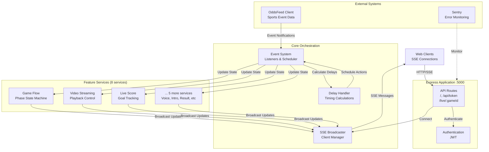
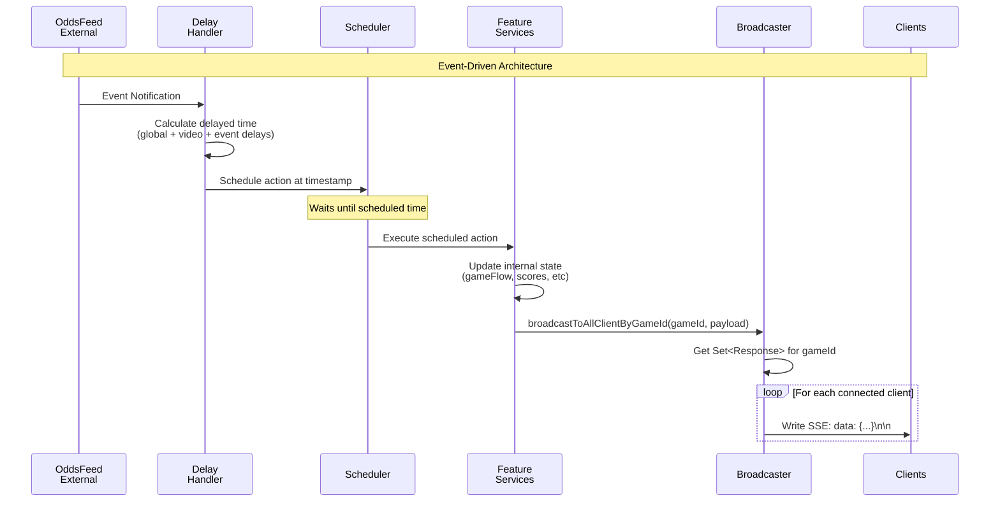
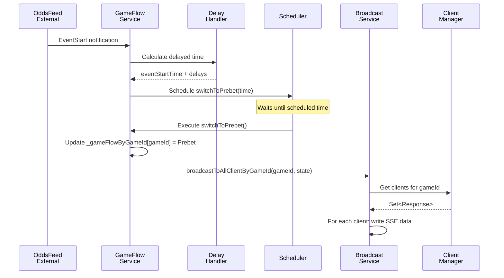
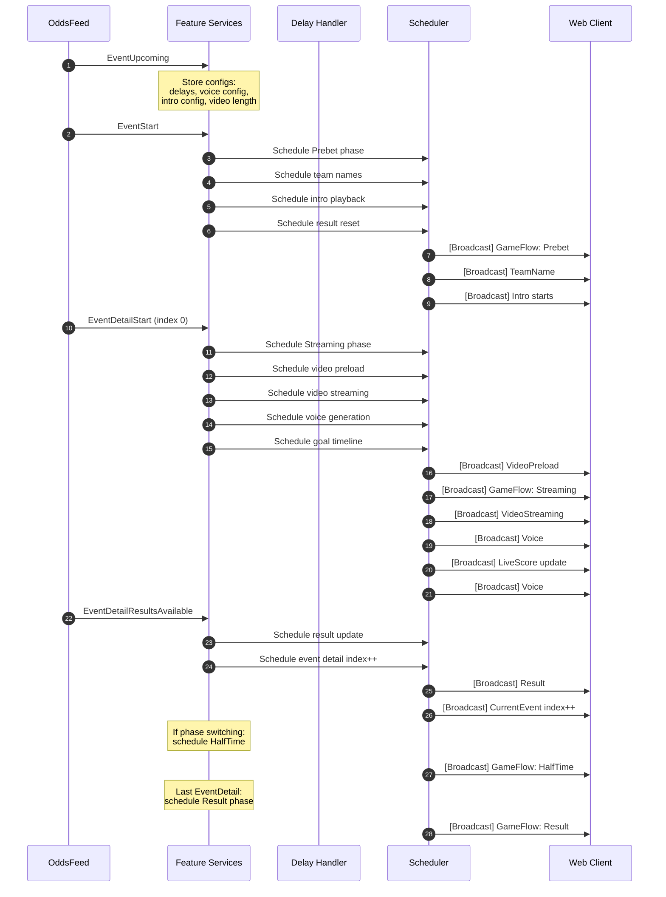

# Streaming Service

A real-time event streaming service built with Node.js, TypeScript, and Express. This service manages live sports events, handles client connections, and broadcasts event updates in real-time using Server-Sent Events (SSE).

## 🚀 Project Overview

The Streaming Service is an **event-driven, real-time sports broadcasting system** that consumes events from an external OddsFeed service and orchestrates synchronized video streaming, live scoring, commentator voices, and UI state transitions for multiple concurrent games.

**Core Purpose:**

- Consume sports event data from `odds-feed-client` (external feed)
- Schedule and coordinate multiple feature services based on event timing
- Broadcast synchronized state updates to connected web clients via SSE
- Handle configurable delays for video synchronization and timing adjustments

**Key Capabilities:**

- **Multi-game concurrent management**: Supports Game IDs 2000-2003 simultaneously
- **Event-driven architecture**: Listens to external OddsFeed events and schedules delayed actions
- **Real-time SSE broadcasting**: Pushes live updates to connected clients per game
- **Phase state management**: Prebet → Streaming → HalfTime → Result transitions
- **Intelligent delay handling**: Configurable global/video/event-type specific delays
- **Video streaming coordination**: Preload and streaming with precise timing
- **Dynamic commentator voice generation**: Context-aware voice selection based on in-game events
- **Live score tracking**: Real-time goal updates during gameplay
- **Debug streaming**: Live service monitoring via SSE for debugging

## 🏗️ Architecture Map

### High-Level Architecture



### Detailed Data Flow



## 🔄 Event-Driven Flow

This system uses a **scheduler-based event-driven architecture**, not cron jobs. All feature services listen to external OddsFeed events and schedule delayed actions.

### Primary Event Flow



### Complete Event Timeline



### Scheduler Details

The `Scheduler` is provided by `odds-feed-client` library:

- **API**: `schedule(date: Date, callback: Function)`
- **Implementation**: Likely uses `setTimeout` or similar
- **Precision**: Schedules callbacks to execute at specific timestamps
- **Cleanup**: Services dispose scheduled tasks on shutdown

### OddsFeed Events

**Event Notifications** (Event-level):

- `EventUpcoming`: Pre-event notification with configs
- `EventStart`: Event begins (triggers Prebet phase)
- Cleanup: Memory cleanup for old events

**Event Detail Notifications** (Per event detail within an event):

- `EventDetailStart`: Video/detail begins (triggers Streaming phase)
- `EventDetailResultsAvailable`: Results for this detail (triggers HalfTime/Result)

**System Notifications**:

- Cleanup events for memory management

## 🎯 Features & Services

### Core Infrastructure Services

#### 1. Client Manager (`src/managers/client-manager.ts`)

**Purpose**: Manages SSE client connections lifecycle

- **Key Methods**:
  - `addClient(res, gameId)`: Registers new SSE connection for a game
  - `removeClient(gameId, res)`: Removes disconnected client
  - `cleanupDeadConnections()`: Runs every 60s to remove dead connections
  - `getClientSetForGame(gameId)`: Returns Set of Response objects
  - `getConnectionStats()`: Returns client counts per game

- **State Management**: `Map<gameId, Set<Response>>`
- **Auto-cleanup**: Interval runs every 60 seconds

#### 2. Game Broadcast Service (`src/services/game-broadcast.service.ts`)

**Purpose**: Broadcasts SSE messages to all clients for a game

- **Key Method**: `broadcastToAllClientByGameId(gameId, payload, eventName)`
- **Message Format**: `data: {"[eventName]": payload, "message": "FeatureBoardCast"}\n\n`
- **Broadcasting**: Iterates through all clients for a gameId and writes SSE data

#### 3. Event Stream Service (`src/services/event-stream-service.ts`)

**Purpose**: Handles initial SSE connection and sends current state

- **Key Method**: `addClient(res, gameId)`
- **Behavior**:
  1. Registers client with ClientManager
  2. Gets current aggregated state from InGameConsumer
  3. Immediately sends current state to new client

#### 4. Delay Handling Service (`src/features/delay/delay-handling-service.ts`)

**Purpose**: Centralizes timing delay calculations for all events

- **Configuration Source**: `EventUpcoming` event → `event.config.delay`
- **Delay Types**:
  - `globalDelayInMillisecond`: Applied to all events
  - `videoDelayInMillisecond`: Additional delay for video sync
  - `eventScheduleStartDelayInMillisecond`: For EventStart
  - `eventDetailScheduleStartDelayInMillisecond`: For EventDetailStart
  - `eventDetailResultAvailableDelayInMillisecond`: For ResultsAvailable

- **Key Methods**:
  - `getDelayedTime({ eventId, time }, { oddsFeedEventType })`: Returns delayed timestamp
  - `getDelayedTimeWithVideoDelay(...)`: Adds video delay on top

### Feature Services (Event-Driven)

All feature services follow a common pattern:

1. Listen to OddsFeed events via `oddsFeedEventSource`
2. Calculate delayed execution time via `delayHandlingService`
3. Schedule actions via `scheduler`
4. Update internal state when scheduled action executes
5. Broadcast updates via `gameBroadcastService`
6. Log debug info via `featureDebugService`

#### 5. Game Flow Service (`src/features/game-flow/game-flow-service.ts`)

**Purpose**: Manages game phase state machine

**Event Listeners**:

- `EventStart` → schedules `switchToPrebet`
- `EventDetailStart` → schedules `switchToStreaming`
- `EventDetailResultsAvailable` → schedules `switchToHalfTime` or `switchToResult`

**State**: `Record<gameId, GameFlow>`

- `GameFlow.Prebet`: Initial betting phase
- `GameFlow.Streaming`: Active video streaming
- `GameFlow.HalfTime`: Break between halves
- `GameFlow.Result`: Final results displayed

**Broadcast**: `{ state: GameFlow }`

#### 6. Current Event Service (`src/features/current-event/current-event-service.ts`)

**Purpose**: Tracks current event ID and event detail index

**Event Listeners**:

- `EventStart` → schedules `handleEventIndexReset` (sets eventDetailIndex = 0)
- `EventDetailResultsAvailable` → schedules `handleEventDetailIndexIncrement`
- `cleanupOn` → cleans up old event data

**State**:

- `_currentEventByGameId: Record<gameId, eventId>`
- `_currentEventDetailIndexByGameId: Record<gameId, index>`
- `_eventByEventId: Record<eventId, Event>` (for phase lookup)

**Broadcast**: `{ event: eventId, eventDetailIndex: number, phase: number }`

#### 7. Video Streaming Service (`src/features/video-streaming/video-streaming-service.ts`)

**Purpose**: Manages video playback state and preloading

**Event Listener**:

- `EventDetailStart` → schedules both `onLiveStreamStart` and `onLiveStreamPreload`

**Timing**:

- **Preload**: `scheduleStartTs` + global delay (no video delay)
- **Streaming**: `scheduleStartTs` + global delay + video delay

**State**:

- `videoLink`: Playlist URL
- `timeToStream`: Absolute timestamp when video should start
- `currentTime`: Calculated as `Date.now() - timeToStream` (for client sync)
- `phaseIndex`: Current phase number
- `timeFromPhaseStart`: First event detail of this phase
- `timeFromPhaseEnd`: Last event detail of this phase

**Broadcasts**:

- `videoStreaming`: Full video state
- `preloadVideo`: Just the next video link

#### 8. Live Score Service (`src/features/live-score/live-score-service.ts`)

**Purpose**: Tracks real-time goal scoring

**Event Listener**:

- `EventDetailStart` → fetches `goalInfo` JSON, schedules goal updates on timeline

**Goal Timeline Scheduling**:

```typescript
goalInfo.timeLine.forEach((time, goalIndex) => {
  const goalTime = new Date(scheduleStartTs).getTime() + time * 1000;
  const timeToUpdate = delayedTimeWithVideoDelay(goalTime);
  scheduler.schedule(timeToUpdate, handleLiveScoreUpdate);
});
```

**State**: `{ homeScore: number, awayScore: number }` per gameId
**Score Logic**: `result === "H" ? +1 home : result === "A" ? +1 away`

#### 9. Result Service (`src/features/result/result-service.ts`)

**Purpose**: Tracks cumulative results by phase

**Event Listeners**:

- `EventStart` → schedules reset to `{ 0: { homeScore: 0, awayScore: 0 } }`
- `EventDetailResultsAvailable` → schedules result update

**State**: `Record<gameId, { result: Record<phase, { homeScore, awayScore }> }>`
**Accumulation**: Adds event detail result to current phase total

#### 10. Commentator Voice Service (`src/features/commentator-voice/commentator-voice-service.ts`)

**Purpose**: Generates and schedules commentator voice files

**Event Listeners**:

- `EventUpcoming` → fetches voice config JSON
- `EventStart` → resets voice state for new event
- `EventDetailStart` → generates voice timeline, schedules individual voices

**Voice Generation Algorithm** (`src/helpers/voices.ts`):

- Uses `inGameEvent.timeLine` and `inGameEvent.eventName` (e.g., "GOAL", "SAVE")
- Considers previous voices to avoid repetition
- Uses first half voices and score for context
- Applies duration constraints from `VoiceDurationConfig`

**Scheduling**: Each voice scheduled at `scheduleStartTs + timeline[i] + videoDelay`

**State Management**: Tracks voices per phase to build cumulative context

#### 11. Intro Service (`src/features/intro/intro-service.ts`)

**Purpose**: Manages intro video playback timing

**Event Listeners**:

- `EventUpcoming` → stores intro config (duration, resourceServer)
- `EventStart` → schedules intro playback for Prebet and HalfTime

**Intro Timing**:

1. **Prebet Intro**: Plays at `EventStart` for `duration` seconds
2. **HalfTime Intro**: Plays `duration` seconds before 2nd half starts

**State**: `{ resourceServer, introTime, timeToPlay, isPlaying, duration }`

#### 12. Team Name Service (`src/features/team-name/team-name-service.ts`)

**Purpose**: Broadcasts team names at event start

**Event Listener**:

- `EventStart` → schedules team name broadcast

**State**: `{ homeTeamName, awayTeamName }` from `event.eventNameAKey/eventNameBKey`

### Support Services

#### 13. In-Game Consumer (`src/features/in-game-consumer/in-game-consumer.ts`)

**Purpose**: Aggregates current state from all feature services

**Method**: `getCurrentByGameId(gameId)` returns:

```typescript
{
  gameFlow: { state: "Prebet" | "Streaming" | ... },
  currentEvent: { event, eventDetailIndex, phase },
  videoStreaming: { videoLink, currentTime, ... },
  preloadVideo: { videoLink },
  result: { result: { [phase]: { homeScore, awayScore } } },
  liveScore: { homeScore, awayScore },
  teamName: { homeTeamName, awayTeamName },
  intro: { resourceServer, introTime, isPlaying, duration }
}
```

Used by `EventStreamService` to send initial state to new connections.

#### 14. Feature Debug Service (`src/features/feature-debug/feature-debug-service.ts`)

**Purpose**: Centralized logging with color-coded output

- **Console Logging**: Only logs enabled services (currently only GameFlowService)
- **Debug Stream**: Stores last 1000 logs per gameId
- **EventEmitter**: Broadcasts logs to debug stream clients
- **Log Format**: `{ serviceName, message, serviceColor, absoluteTime, relativeTime }`
- **Relative Time**: Calculated from GameFlowService track point (Prebet start)

## 📋 Component Guide

### Application Initialization

**File**: `src/app.ts`

```typescript
const run = async () => {
  // 1. Initialize Sentry and logging
  const configuration = new Configuration();
  await configuration.configureDatabaseAndSentry(appConfigs);

  // 2. Setup dependency injection
  const containerRegistry = new ContainerRegistry();
  const container = containerRegistry.register(); // Register all services
  containerRegistry.init(); // Initialize event listeners

  // 3. Configure Express
  const app = express();
  app.use(express.static(path.join(process.cwd(), "public")));
  app.use(express.json());
  app.use(corsMiddleware);

  // 4. Setup routes
  app.use(setupRoutes(container));
  app.use(errorHandler);

  // 5. Start server
  const server = app.listen(appConfigs.hostingPort);

  // 6. Graceful shutdown handlers
  process.on("SIGTERM", async () => gracefulShutdown("SIGTERM"));
  process.on("SIGINT", async () => gracefulShutdown("SIGINT"));
};
```

### Dependency Injection

**Main Container** (`src/container-registry.ts`):

```typescript
// 1. Register odds-feed-client services
register(this.diContainer);

// 2. Register core services
this.container.register({
  clientManager: asClass(ClientManager).singleton().disposer(...)
  eventStreamService: asClass(EventStreamService).singleton(),
  authenticateService: asClass(AuthenticateService).singleton(),
});

// 3. Register controllers
this.container.register({
  authController: asClass(AuthController).singleton(),
  eventStreamController: asClass(EventStreamController).singleton(),
});

// 4. Register feature services (with lazy loading)
registerContainer(this.container);

// 5. Initialize all feature services
init(this.diContainer);
initContainer(this.container);
```

**Feature Services** (`src/features/container-registry.ts`):

Uses **lazy loading** with Proxy pattern to handle circular dependencies:

```typescript
// Circular dependency: GameFlowService ↔ FeatureDebugService
container.register({
  gameFlowService: asFunction((cradle) => new GameFlowService({
    featureDebugService: lazy(() => cradle.featureDebugService), // Lazy!
    // ... other deps
  })).singleton().disposer(...),

  featureDebugService: asFunction((cradle) => new FeatureDebugService({
    gameFlowService: lazy(() => cradle.gameFlowService), // Lazy!
  })).singleton().disposer(...),
});
```

**Initialization** calls `initEvent()` on all feature services to register event listeners.

### API Routes

**File**: `src/routes/index.ts`

| Method | Path                    | Auth | Controller            | Purpose                           |
| ------ | ----------------------- | ---- | --------------------- | --------------------------------- |
| GET    | `/`                     | No   | HealthController      | Health check with connection info |
| POST   | `/api/token`            | No   | AuthController        | JWT token generation              |
| GET    | `/live/:gameId`         | No\* | EventStreamController | SSE event stream connection       |
| GET    | `/debug-stream/:gameId` | No\* | DebugController       | Debug logging SSE stream          |

\*Note: JWT middleware (`verifyJWT`) is **not currently applied** to these routes. This is a potential security issue.

### Controllers

#### Health Controller (`src/controllers/health-controller.ts`)

```typescript
healthCheck(req, res) {
  res.json({
    status: "ok",
    message: "Streaming service running",
    timestamp: new Date().toISOString(),
    clientIP: req.ip,
    host: req.headers.host,
    forwardedFor: req.headers["x-forwarded-for"],
    remoteAddress: req.socket.remoteAddress,
  });
}
```

#### Auth Controller (`src/controllers/auth-controller.ts`)

```typescript
async login(req, res) {
  const { operatorId, password } = req.body;
  const token = await authenticateService.getAuthenticatedToken(operatorId, password);
  res.json({ token });
}
```

Validates against hardcoded credentials in `appConfigs.jwt`.

#### Event Stream Controller (`src/controllers/event-stream-controller.ts`)

```typescript
handleEventStreamConnection(req, res) {
  const gameId = req.params.gameId;

  // Setup SSE headers
  res.setHeader("Content-Type", "text/event-stream");
  res.setHeader("Cache-Control", "no-cache");
  res.setHeader("Connection", "keep-alive");
  res.flushHeaders();

  // Add client and send initial state
  eventStreamService.addClient(res, gameId);
}
```

#### Debug Controller (`src/controllers/debug-controller.ts`)

Similar SSE setup, but:

1. Gets debug event emitter for gameId
2. Sends historical logs (last 1000)
3. Converts ANSI colors to HTML colors
4. Streams new logs as they arrive

### Middlewares

#### CORS Middleware (`src/middlewares/cors.ts`)

```typescript
validateOrigin(origin, host) {
  // Allow if no origin (same-origin)
  if (!origin) return true;

  // Allow localhost:7456-7459
  if (/^https?:\/\/localhost:745(6|7|8|9)$/.test(origin)) return true;

  // Allow same domain
  const originDomain = getDomain(origin); // Uses tldts
  const hostDomain = getDomain(host);
  return originDomain === hostDomain;
}
```

Applied to all routes except `/`.

#### Error Handler (`src/middlewares/error-handler.ts`)

**Current**: Very basic, returns 400 for all errors

```typescript
export const errorHandler = (err, req, res, next) => {
  res.status(400).json({ error: "Bad Request", message: err.message });
};
```

#### Verify JWT (`src/middlewares/verify-jwt.ts`)

Checks `Authorization: Bearer <token>` or query param `?token=<token>`.

**Not currently used** in route setup.

### Configuration

**App Configs** (`src/app-configs.ts`):

```typescript
export const appConfigs = {
  hostingPort: 5000,
  sentry: { sentryUrl: "...", logIdentifier: "Streaming-Service", env: "DEV" },
  jwt: { username: "marble-tv", password: "marble-tv-123", secret: "stream-service-secret" },
  oddsFeedAPI: { url: "...", operatorId: "...", password: "..." },
};
```

**Environment-specific configs**: `configs/app-configs.LOCAL.js`, `app-configs.UAT.js`, `app-configs.KLPROD.js` (not currently loaded)

**App Settings** (`src/app-settings.ts`):

Fallback settings per game ID:

- `videoLength`: Default 30 seconds for games 2000-2003
- `scheduleDelay`: 10s for games 2001-2003
- `videoDelay`: 3s for all games
- `introDuration`: 8s for game 2000

### Helper Utilities

**ID Helper** (`src/helpers/id-helper.ts`):

Event ID encoding: `eventId = (gameId << 32) + roundId`

```typescript
extractGameId(eventId: number): string // Returns gameId as string
extractRoundId(eventId: number): number
createEventId(gameId: number, roundId: number): number
```

**Phase Helper** (`src/helpers/phase-helper.ts`):

```typescript
isPhaseSwitching({ event, index }); // true if next detail has different phase
isLastEventDetail({ event, index }); // true if this is last detail
```

**Voice Generator** (`src/helpers/voices.ts`):

Complex algorithm for voice selection:

- Avoids repeating recent voices
- Considers event types (GOAL, SAVE, etc.)
- Uses duration constraints
- Contextual based on first half score

## 🔌 Integration Guide

### Integration with odds-feed-client

This service integrates with the `odds-feed-client` library to receive real-time sports event data. All feature services follow a common integration pattern.

#### Service Initialization Pattern

Every feature service implements the following lifecycle:

```typescript
import { OddsFeedEventSource, OddsFeedEventName, EventNotification } from "odds-feed-client";

export class ExampleService {
  private readonly oddsFeedEventSource: OddsFeedEventSource;
  private readonly boundHandleEvent: (notification: EventNotification) => void;

  constructor(container) {
    this.oddsFeedEventSource = container.oddsFeedEventSource;

    // Store bound methods for proper cleanup
    this.boundHandleEvent = this.handleEvent.bind(this);
  }

  // 1. Register event listeners
  public initEvent() {
    this.oddsFeedEventSource.eventOn(OddsFeedEventName.EventStart, this.boundHandleEvent);
  }

  // 2. Handle events
  private handleEvent({ event }: EventNotification) {
    // Process event...
  }

  // 3. Cleanup on shutdown
  public dispose() {
    this.oddsFeedEventSource.eventOff(OddsFeedEventName.EventStart, this.boundHandleEvent);
  }
}
```

#### Available OddsFeed Events

**Event-level notifications** (triggered per event):

| Event Name      | When Triggered               | Notification Type   | Use Case                                  |
| --------------- | ---------------------------- | ------------------- | ----------------------------------------- |
| `EventUpcoming` | Pre-event (receives configs) | `EventNotification` | Load event configs (delays, intro, voice) |
| `EventStart`    | Event begins                 | `EventNotification` | Initialize Prebet phase, reset state      |

**Event Detail notifications** (triggered per event detail):

| Event Name                    | When Triggered      | Notification Type         | Use Case                               |
| ----------------------------- | ------------------- | ------------------------- | -------------------------------------- |
| `EventDetailStart`            | Video/detail begins | `EventDetailNotification` | Start video streaming, schedule voices |
| `EventDetailResultsAvailable` | Results ready       | `EventDetailNotification` | Update scores, transition phases       |

**System notifications**:

| Event Name | When Triggered | Notification Type    | Use Case                          |
| ---------- | -------------- | -------------------- | --------------------------------- |
| `cleanup`  | Event cleanup  | `SystemNotification` | Remove old event data from memory |

#### Event Listener Examples

**Example 1: Listen to multiple event types**

```typescript
// src/features/game-flow/game-flow-service.ts
public initEvent() {
  // Listen to Event-level notifications
  this.oddsFeedEventSource.eventOn(
    OddsFeedEventName.EventStart,
    this.boundHandleEventStart
  );

  // Listen to EventDetail-level notifications
  this.oddsFeedEventSource.eventDetailOn(
    OddsFeedEventName.EventDetailStart,
    this.boundHandleEventDetailScheduleStart
  );

  this.oddsFeedEventSource.eventDetailOn(
    OddsFeedEventName.EventDetailResultsAvailable,
    this.boundHandleResultAvailable
  );
}

public dispose() {
  this.oddsFeedEventSource.eventOff(
    OddsFeedEventName.EventStart,
    this.boundHandleEventStart
  );

  this.oddsFeedEventSource.eventDetailOff(
    OddsFeedEventName.EventDetailStart,
    this.boundHandleEventDetailScheduleStart
  );

  this.oddsFeedEventSource.eventDetailOff(
    OddsFeedEventName.EventDetailResultsAvailable,
    this.boundHandleResultAvailable
  );
}
```

**Example 2: Cleanup listener**

```typescript
// src/features/current-event/current-event-service.ts
public initEvent() {
  this.oddsFeedEventSource.eventOn(
    OddsFeedEventName.EventStart,
    this.boundHandleEventStart
  );

  // System cleanup events
  this.oddsFeedEventSource.cleanupOn(this.boundHandleEventCleanup);
}

public cleanup({ eventID }: SystemNotification) {
  // Remove old event data to prevent memory leaks
  delete this._eventByEventId[eventID];
}

public dispose() {
  this.oddsFeedEventSource.eventOff(
    OddsFeedEventName.EventStart,
    this.boundHandleEventStart
  );

  this.oddsFeedEventSource.cleanupOff(this.boundHandleEventCleanup);
}
```

#### Service Registration

Services are registered in `src/features/container-registry.ts` and initialized in order:

```typescript
export function registerContainer(container) {
  container.register({
    delayHandlingService: asClass(DelayHandlingService)
      .singleton()
      .disposer((service) => service.dispose()),

    gameFlowService: asClass(GameFlowService)
      .singleton()
      .disposer((service) => service.dispose()),

    // ... other services
  });
}

export function initContainer(container) {
  // Initialize event listeners in order
  container.resolve("delayHandlingService").initEvent();
  container.resolve("gameFlowService").initEvent();
  container.resolve("currentEventService").initEvent();
  // ... other services
}
```

### Integration with Admin Event Configuration

Event configuration is provided by the Admin system through the `EventUpcoming` notification. Services listen to this event to receive event-specific configurations.

#### Event Config Structure

The Admin system sends event configuration in the following structure:

```json
{
  "eventID": 8589934592,
  "scheduleStartTs": "2025-01-15T10:00:00Z",
  "eventDetails": [...],
  "config": {
    "delay": {
      "globalDelayInMillisecond": 10000,
      "videoDelayInMillisecond": 3000,
      "eventScheduleStartDelayInMillisecond": 0,
      "eventDetailScheduleStartDelayInMillisecond": 0,
      "eventDetailResultAvailableDelayInMillisecond": 0
    },
    "intro": {
      "duration": 8,
      "resourceServer": "https://d1aof1lwumql9k.cloudfront.net/marble_tv/"
    },
    "voice": {
      "configJson": "https://d1aof1lwumql9k.cloudfront.net/youtube/config_voice.json"
    },
    "video": {
      "defaultLength": 30
    }
  }
}
```

#### Configuration Fields

**Delay Configuration** (`config.delay`):

| Field                                          | Type   | Description                     | Default |
| ---------------------------------------------- | ------ | ------------------------------- | ------- |
| `globalDelayInMillisecond`                     | number | Applied to all scheduled events | 0       |
| `videoDelayInMillisecond`                      | number | Additional delay for video sync | 0       |
| `eventScheduleStartDelayInMillisecond`         | number | Delay for EventStart            | 0       |
| `eventDetailScheduleStartDelayInMillisecond`   | number | Delay for EventDetailStart      | 0       |
| `eventDetailResultAvailableDelayInMillisecond` | number | Delay for ResultsAvailable      | 0       |

**Intro Configuration** (`config.intro`):

| Field            | Type   | Description                       |
| ---------------- | ------ | --------------------------------- |
| `duration`       | number | Intro video duration in seconds   |
| `resourceServer` | string | CDN URL for intro video resources |

**Voice Configuration** (`config.voice`):

| Field        | Type   | Description                              |
| ------------ | ------ | ---------------------------------------- |
| `configJson` | string | URL to voice duration configuration JSON |

**Video Configuration** (`config.video`):

| Field           | Type   | Description                     |
| --------------- | ------ | ------------------------------- |
| `defaultLength` | number | Default video length in seconds |

#### Accessing Config in Services

**Example 1: Delay Handling Service**

```typescript
// src/features/delay/delay-handling-service.ts
public handleEventUpcoming({ event }: EventNotification) {
  const config = event.config?.delay;
  if (config) {
    this._delayConfigByEventId[event.eventID] = config;
  }
}

public getDelayedTime({ eventId, time }, { oddsFeedEventType }) {
  const config = this._delayConfigByEventId[eventId];
  if (!config) {
    return time; // No delay if config not found
  }

  const globalDelay = config.globalDelayInMillisecond ?? 0;
  const eventTypeDelay = this.getDelayConfigByEventType(eventId, oddsFeedEventType);

  return new Date(time.getTime() + globalDelay + eventTypeDelay);
}

public getDelayedTimeWithVideoDelay({ eventId, time }, { oddsFeedEventType }) {
  const config = this._delayConfigByEventId[eventId];
  if (!config) {
    return time;
  }

  const videoDelay = config.videoDelayInMillisecond ?? 0;
  const baseDelayedTime = this.getDelayedTime({ eventId, time }, { oddsFeedEventType });

  return new Date(baseDelayedTime.getTime() + videoDelay);
}
```

**Example 2: Intro Service**

```typescript
// src/features/intro/intro-service.ts
public handleEventUpcoming({ event }: EventNotification) {
  const config = event.config?.intro;
  if (config) {
    this._introConfigByEventId[event.eventID] = {
      resourceServer: config.resourceServer,
      duration: config.duration,
    };
  }
}

public handleEventStart({ event }: EventNotification) {
  const config = this._introConfigByEventId[event.eventID];

  if (!config) {
    return; // No intro if config not provided
  }

  const duration = config.duration;
  const durationInMillis = duration * 1000;

  // Schedule intro playback for Prebet phase
  const timeToPlayPrebetIntro = this.delayHandlingService.getDelayedTime(
    { eventId: event.eventID, time: new Date(event.scheduleStartTs) },
    { oddsFeedEventType: OddsFeedEventName.EventStart }
  );

  this.scheduler.schedule(
    timeToPlayPrebetIntro,
    this.updateIntroStatus.bind(this, {
      eventID: event.eventID,
      timeToPlay: timeToPlayPrebetIntro.getTime()
    })
  );
}
```

**Example 3: Commentator Voice Service**

```typescript
// src/features/commentator-voice/commentator-voice-service.ts
public async handleEventUpcoming({ event }: EventNotification) {
  // Get video length from config or fallback to app settings
  const videoLength =
    event.config?.video?.defaultLength
    ?? appSettings.videoLength[gameId]
    ?? 30; // Default 30 seconds

  this._videoLengthByEventId[event.eventID] = videoLength;

  // Get voice config from remote JSON
  const voiceConfig = event.config?.voice;

  if (!voiceConfig) {
    return; // No voice generation if config not provided
  }

  const configJson = voiceConfig.configJson;
  const voiceDurationConfig = await this.oddsFeedService.getRemoteJson<VoiceDurationConfig>(
    configJson,
    { eventId: event.eventID }
  );

  if (voiceDurationConfig) {
    this._commentatorVoiceConfigByEventId[event.eventID] = {
      configJson,
      configVoice: voiceDurationConfig,
    };
  }
}
```

#### Config Validation

Currently, the service uses **optional chaining** (`?.`) to handle missing configs gracefully. If a config is not provided, the service either:

1. **Falls back to `appSettings`** (legacy, to be removed)
2. **Skips the feature** (e.g., no intro if `config.intro` is missing)
3. **Uses default values** (e.g., 0 delay)

#### Configuration in Admin System

To configure an event in the Admin system:

1. Navigate to Event Management
2. Create or edit an event
3. Add the `config` object with required fields
4. The configuration will be sent via `EventUpcoming` notification
5. Services will automatically use the config when processing the event

**Example Admin API Request**:

```json
POST /api/events
{
  "eventID": 8589934592,
  "scheduleStartTs": "2025-01-15T10:00:00Z",
  "eventDetails": [...],
  "config": {
    "delay": {
      "globalDelayInMillisecond": 10000,
      "videoDelayInMillisecond": 3000
    },
    "intro": {
      "duration": 8,
      "resourceServer": "https://d1aof1lwumql9k.cloudfront.net/marble_tv/"
    },
    "voice": {
      "configJson": "https://d1aof1lwumql9k.cloudfront.net/youtube/config_voice.json"
    },
    "video": {
      "defaultLength": 30
    }
  }
}
```

#### Memory Management

Event configurations are stored per `eventID` and should be cleaned up when events complete:

```typescript
// Cleanup listener example
public handleEventCleanup({ eventID }: SystemNotification) {
  delete this._videoLengthByEventId[eventID];
  delete this._commentatorVoiceConfigByEventId[eventID];
  delete this._delayConfigByEventId[eventID];
  delete this._introConfigByEventId[eventID];
}
```

This prevents memory leaks in long-running services handling many events.

## 🔧 Improvements & Refactors

### High Priority

#### 1. Remove appSettings Fallback - Use Admin Config Only

**Scope**: Small | **Impact**: High

**Current Issue**:

The codebase has two sources of configuration that create confusion and maintenance overhead:

```typescript
// src/app-settings.ts - Legacy fallback configuration
export const appSettings = {
  videoLength: {
    "2000": 30,
    "2001": 30,
    "2002": 30,
    "2003": 30,
  } as Record<string, number>,

  scheduleDelay: {
    "2001": 10 * 1000,
    "2002": 10 * 1000,
    "2003": 10 * 1000,
  } as Record<string, number>,

  videoDelay: {
    "2000": 3 * 1000,
    "2001": 3 * 1000,
    "2002": 3 * 1000,
    "2003": 3 * 1000,
  } as Record<string, number>,
};
```

Services currently fall back to `appSettings` when admin config is missing:

```typescript
// src/features/commentator-voice/commentator-voice-service.ts (lines 124-127)
const videoLength =
  (event as any).config?.video?.videoLength ??
  appSettings.videoLength[gameId] ?? // ❌ Fallback to hardcoded values
  GLOBAL_DEFAULT_VIDEO_LENGTH;
```

**Problems**:

1. **Dual configuration sources**: Changes must be made in two places
2. **Confusion**: Unclear which config takes precedence
3. **Maintenance burden**: Hardcoded values need code deployment to update
4. **Inconsistency**: Not all games have same settings, requires code changes
5. **Admin UI disconnect**: Admin config should be single source of truth

**Improvement**:

**Files to Update**:

- ❌ **Delete**: `src/app-settings.ts`
- ✏️ **Update**: `src/features/commentator-voice/commentator-voice-service.ts` (remove appSettings import and fallback)
- ✏️ **Update**: Any other services importing `appSettings`

---

### Medium Priority

#### 2. Circular Dependency Simplification

**Scope**: Medium | **Impact**: Medium

**Current Issue**:

```typescript
// src/features/container-registry.ts (lines 45-60)
gameFlowService: asFunction((cradle) => new GameFlowService({
  featureDebugService: lazy(() => cradle.featureDebugService),
  // ...
})),
featureDebugService: asFunction((cradle) => new FeatureDebugService({
  gameFlowService: lazy(() => cradle.gameFlowService),
})),
```

**Root Cause**: `GameFlowService` logs to `FeatureDebugService`, which needs `GameFlowService.getTrackPointByGameId()` for relative time calculation.

**Improvement Recommend**:

Extract timing logic to a separate `TimeTrackingService`:

```typescript
class TimeTrackingService {
  private trackPointByGameId: Record<string, number> = {};

  setTrackPoint(gameId: string, timestamp: number) {
    this.trackPointByGameId[gameId] = timestamp;
  }

  getRelativeTime(gameId: string): number {
    return (Date.now() - (this.trackPointByGameId[gameId] ?? Date.now())) / 1000;
  }
}
```

Then:

- `GameFlowService` updates track point when switching to Prebet
- `FeatureDebugService` uses `TimeTrackingService` for relative time
- No circular dependency

---

## 📊 Monitoring & Observability

### Current Monitoring

1. **Sentry Integration** (`src/configuration.ts`):
   - Error tracking via `sc-common` logger
   - Configured with `sentryUrl`, `logIdentifier`, and `env`

2. **Debug Service** (`debug/?game=${gameId}`):
   - Real-time service logging via SSE
   - Color-coded by service
   - Shows relative time from Prebet start
   - Last 1000 logs stored per game

3. **Health Endpoint** (`/`):
   - Returns service status
   - Client IP and connection info
   - No service health checks

## 📝 Development

### Running Locally

```bash
# Install dependencies
npm install  # or yarn

# Development with auto-reload
npm run dev

# Build for production
npm run build

# Start production build
npm start
```

### Testing

```bash
# Run all tests
npm test

# Run with coverage
npm run test-coverage

# Format code
npm run format

# Check formatting
npm run lint
```

### Project Structure

```
src/
├── app.ts                      # Entry point
├── configuration.ts            # Sentry setup
├── container-registry.ts       # Main DI container
├── app-configs.ts             # Hardcoded configs (to be replaced)
├── app-settings.ts            # Game-specific fallbacks
├── types/                     # TypeScript type definitions
├── controllers/               # HTTP request handlers
│   ├── auth-controller.ts
│   ├── event-stream-controller.ts
│   ├── health-controller.ts
│   └── debug-controller.ts
├── middlewares/               # Express middlewares
│   ├── cors.ts
│   ├── error-handler.ts
│   └── verify-jwt.ts
├── routes/                    # Route definitions
│   └── index.ts
├── managers/                  # Infrastructure managers
│   └── client-manager.ts
├── services/                  # Core services
│   ├── authenticate-service.ts
│   ├── event-stream-service.ts
│   └── game-broadcast.service.ts
├── features/                  # Feature services
│   ├── container-registry.ts
│   ├── commentator-voice/
│   ├── current-event/
│   ├── delay/
│   ├── feature-debug/
│   ├── game-flow/
│   ├── in-game-consumer/
│   ├── intro/
│   ├── live-score/
│   ├── result/
│   ├── team-name/
│   └── video-streaming/
└── helpers/                   # Utility functions
    ├── id-helper.ts
    ├── phase-helper.ts
    ├── voices.ts
    └── log.ts
```

## 🧐 Debugging

1. **Debug Stream**: Open `http://localhost:5000/debug/?game=2000` (replace 2000 with gameId)
2. **Health Check**: `http://localhost:5000/`
3. **Connect Client**: `http://localhost:5000/live/2000`

## 🛠️ Technical Stack

### Core Technologies

- **Node.js** (v24) with **TypeScript 5.9**
- **Express.js 5.1** for HTTP server and routing
- **Server-Sent Events (SSE)** for real-time unidirectional communication
- **Awilix 12.0** for dependency injection (PROXY mode)
- **Jest 30.1** for testing framework

### External Dependencies

- **odds-feed-client 2.0**: External event data integration
  - Provides `OddsFeedEventSource`, `Scheduler`, `OddsFeedService`
  - Event-driven architecture with typed notifications
- **sc-common 3.0**: Shared logging and utilities
  - Provides `logger` with Sentry integration
- **jsonwebtoken 9.0**: JWT authentication
- **cors 2.8** with **tldts 7.0**: CORS with domain validation
- **chance 1.1**: Random voice selection

### Development Tools

- **tsx 4.20**: TypeScript execution for development
- **ts-jest 29.4**: TypeScript Jest transformer
- **prettier 3.6**: Code formatting
- **Docker**: Containerization (see `Dockerfile`)
- **Sentry**: Error monitoring and performance tracking

### Build & Deployment

- **Build**: TypeScript compilation + static files copy
- **Runtime**: `extensionless` loader for ES modules without extensions
- **Module System**: ES Modules (`"type": "module"`)

## 📚 Additional Resources

- **odds-feed-client**: [Odds Feed Client](https://git3.nexdev.net/l1/marble-games/odds-feed-client)
- **Server-Sent Events**: [MDN SSE Guide](https://developer.mozilla.org/en-US/docs/Web/API/Server-sent_events)
- **Awilix DI**: [Awilix Documentation](https://github.com/jeffijoe/awilix)

## 📝 License

This project is proprietary and confidential.

## 🆘 Support

For support and questions:

- Create an issue in the repository
- Contact the development team
- Check the debug stream for real-time service status: `/debug/?game=${gameId}`
- Review logs for debugging information

---

**Last Updated**: Based on codebase analysis October 2025
